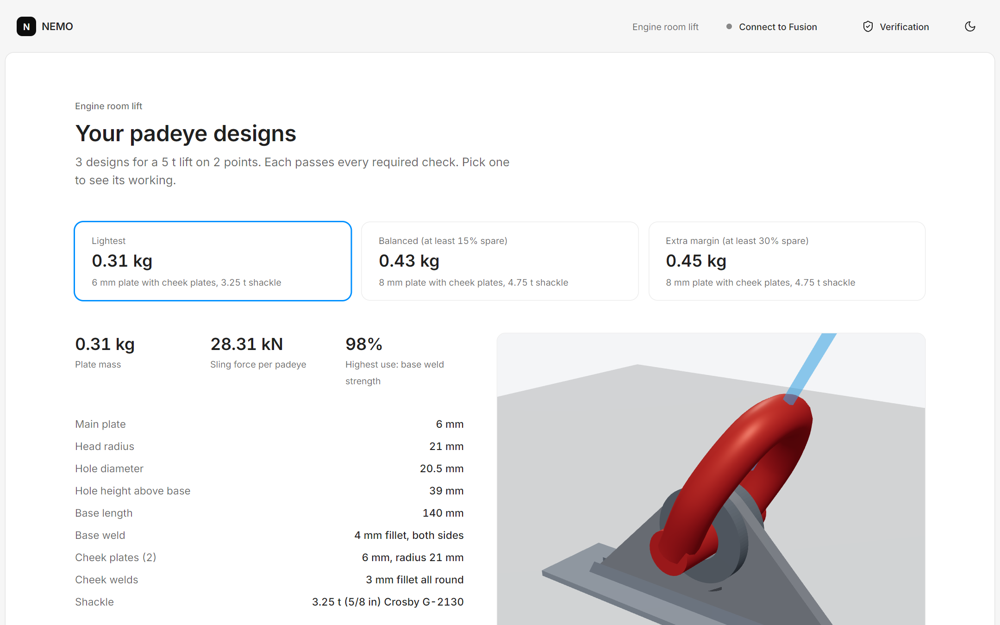
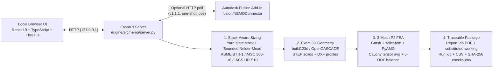

# NEMO

**Rule-based design, 3D finite element verification, and fabrication packages for marine steelwork.**


---

NEMO is a local desktop engineering tool built for marine secondary steelwork:
**lifting padeyes**, **machinery-space pipe support brackets**, and
**roll-stabilizer fin internal structures**. From a plain engineering
description of the shipboard service condition and the shipyard's available
plate thicknesses, NEMO sizes three buildable options (`Lightest`, `Balanced`,
and `Extra margin`), builds exact 3D solids, runs an automated three-mesh
quadratic finite element check, and compiles a self-contained PDF calculation
package alongside `STEP` and `DXF` fabrication files.

> [!IMPORTANT]
> NEMO is an engineering design aid. A competent engineer must review every
> design, its supporting hull or deck structure, and its lifting or installation
> arrangement before fabrication or use.



---

## Marine Steelwork Scope

| Component | Design Standard & Load Model | Automated 3D FEA Scope | Fabrication & Review Outputs |
| --- | --- | --- | --- |
| **Lifting padeye** | ASME BTH-1 pin-connected plate, shackle fit & base fillet welds (15 checks); dynamic factor, sling inclination & oblique side load | Full 3D padeye + cheek plates, cosine pin bearing + uniform 360° axial side load, 3-mesh P2 tets | PDF calculation package & drawing, `STEP` solid, `DXF` cutting profile, optional Autodesk Fusion parametric sync (`v1.1.1`) |
| **Pipe support bracket** | AISC 360-16 ASD seat, knees, U-bolt & bulkhead welds (14 checks); 3-axis ship-motion inertia + machinery-space pipe-span resonance screening | Full 3D welded seat + twin knees under combined vertical, lateral & friction loads, 3-mesh P2 tets | PDF calculation package & span frequency chart, `STEP` solid, `DXF` plate profiles |
| **Roll-stabilizer fin** | IACS UR S10 adapted rudder/stock rules (11 checks); Whicker-Fehlner low-aspect-ratio lift vs. UR S10 force (larger governs), Hess-Smith panel cavitation check | Solid fin stock under combined hydrodynamic bending & torsion at outer bearing, 3-mesh P2 tets | PDF calculation package & $C_p$ cavitation plot, `STEP` fin & stock solids, `DXF` rib cutting profile |

---

## System Architecture & Verification Pipeline



Every run writes an auditable project folder containing `results.json`,
`engineering-log.json`, `designs-evaluated.csv`, `STEP` solids, `DXF` cutting
profiles, and a self-contained calculation report PDF with SHA-256 integrity
hashes. Opening an existing project never triggers a hidden recalculation.

---

## Verification Snapshot

Every analytical, geometric, hydrodynamic, and finite element solver is checked
both in the automated test suite (`181` passing `pytest` tests across `15` test
files) and on the live **Verification** page inside the desktop app (`60.0 s`
full rerun):

| Verification Benchmark | Reference Basis | Recorded Agreement |
| --- | --- | --- |
| Padeye code checks | Worked ASME BTH-1 hand calculation | Within `0.002%` |
| 3D solid geometry volume | Exact analytical volume formula | `0.000%` |
| Cantilever beam (deflection / bending stress) | Timoshenko beam theory | `-0.80%` / `+2.63%` |
| Plate with a circular hole ($K_t$) | Heywood / Peterson stress concentration | `+0.91%` |
| Circular pin-loaded lug ($d/W = 0.50, H/W = 0.50$) | Frocht-Hill photoelastic bounds | $K_{tn} = 3.21$ (within bounds) |
| Hess-Smith panel method (circle $C_p$ / NACA lift slope) | Potential-flow theory / Abbott & von Doenhoff | `-0.05%` / `+1.09%` to `+1.65%` |
| Fin stock combined bending and torsion | Closed-form beam & torsion theory (IACS UR S10.4) | `-0.13%` |
| Case-study 3-mesh FEA convergence & 6-DOF equilibrium | Richardson mesh sequence + force/moment residuals | $\le 0.70\%$ change; balance $< 10^{-11}$ |

---

## Quick Start

### End Users (Windows — no programming or Node.js required)

New to NEMO and downloading from GitHub? Follow
[Installing NEMO from GitHub](docs/install-from-github.md).

If you already have the repository folder on your computer:

1. Double-click **`Install NEMO.bat`** (first time only; requires internet access to install pinned Python packages from `engine/constraints.txt`).
2. Double-click the **NEMO** desktop shortcut (or **`Start NEMO.bat`**).

Full walkthrough: [Getting started](docs/getting-started.md).

### Developers

```powershell
# 1. Python calculation engine & test suite (181 tests)
cd engine
python -m venv .venv
.\.venv\Scripts\python.exe -m pip install -e ".[dev]" -c constraints.txt
.\.venv\Scripts\python.exe -m pytest -q

# 2. Frontend (optional — prebuilt app/dist is committed for zero-Node installs)
cd ..\app
npm ci
npm run build
```

Run backend and frontend with live reload in two terminals:

```powershell
cd engine; .\.venv\Scripts\python.exe -m nemo.server --no-browser
cd app; npm run dev
```

Verify the LaTeX project report against all style, framing, figure, and build-log rules:

```powershell
engine\.venv\Scripts\python.exe .agents\skills\nemo-report-updates\scripts\verify_report.py
```

---

## Documentation

| Guide | Audience & Contents |
| --- | --- |
| [Installing NEMO from GitHub](docs/install-from-github.md) | Step-by-step Windows setup for non-programmers |
| [Getting started](docs/getting-started.md) | First run and workflow walkthrough |
| [User guide](docs/user-guide.md) | Every application screen explained with worked examples |
| [Pipe support brackets](docs/pipe-support-brackets.md) | Ship-motion inertia, AISC 360-16 checks and pipe-span resonance |
| [Stabilizer fins](docs/stabilizer-fins.md) | Foil loads, IACS UR S10 checks and cavitation advice |
| [Understanding your results](docs/understanding-results.md) | Interpreting utilisations, convergence and stress fields |
| [Using NEMO with Fusion](docs/using-nemo-with-fusion.md) | Parametric CAD connector (`v1.1.1`), edit re-checks and cross-checks |
| [Engineering manual](docs/engineering-manual.md) | Governing equations, code clauses and benchmark proofs |
| [Limits and safety](docs/limits-and-safety.md) | Explicit scope boundaries and what NEMO does not check |
| [Glossary](docs/glossary.md) | Marine structural terms in plain language |
| [Troubleshooting](docs/troubleshooting.md) | Common installation, solver and Fusion connector fixes |
| [Developer guide](docs/developer-guide.md) | Module layout, solver conventions and adding new parts or rule sets |
| [Agent skills (report updates & `/teach`)](docs/agent-skills.md) | Maintaining the LaTeX report with `nemo-report-updates` and using `/teach` |
| [Project report (`main.pdf`)](reports/project-report/main.pdf) | Compiled JKUAT final-year BSc Marine Engineering report |

---

## Repository Structure

| Path | Contents |
| --- | --- |
| `engine/` | Python calculation engine: rule sets, sizing, build123d CAD, Gmsh/scikit-fem FEA, ReportLab PDFs, FastAPI server and `181` tests |
| `app/` | React 19 + TypeScript + Three.js browser interface (`app/dist/` committed for offline/no-Node installs) |
| `fusion/` | Optional Autodesk Fusion add-in (`NEMOConnector` `v1.1.1`) for parametric padeye handoff and stress cross-checks |
| `reports/project-report/` | JKUAT LaTeX project report (`main.tex`, `structure/*.tex`, `references.bib`, reproducible data/figure scripts and `main.pdf`) |
| `docs/` | Plain-language user guides, engineering manual, developer guide and agent-skill documentation |
| `.agents/skills/` | Workspace agent skills: `nemo-report-updates` (with `verify_report.py`) and vendored upstream `teach` |
| `tools/` | Windows installer (`install.ps1`) and Fusion connector icon generator |
| `PLAN.md` | Original architecture decisions and implementation milestones |
