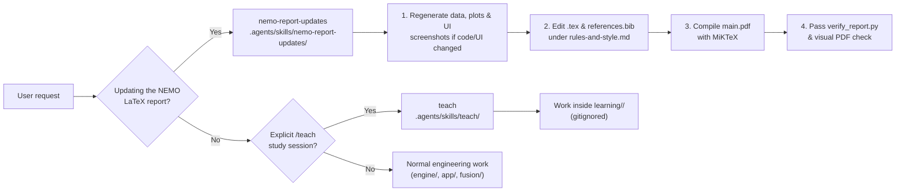

# Agent skills in this repository

This repository ships two workspace skills under `.agents/skills/` so coding
agents (Antigravity, Claude Code, Cursor, and other `SKILL.md`-compatible tools)
can maintain the LaTeX project report safely and run structured multi-session
study workspaces inside the repo:

| Skill | Location | Purpose | Invocation |
| --- | --- | --- | --- |
| `nemo-report-updates` | `.agents/skills/nemo-report-updates/` | Update, synchronize, verify, and compile NEMO's JKUAT LaTeX project report (`reports/project-report/`) | Automatic when you ask to edit or rebuild the report |
| `teach` | `.agents/skills/teach/` | Stateful, multi-session guided learning workspace (Matt Pocock's `teach` skill) | Explicit only (`/teach`) |



---

## 1. Updating the project report (`nemo-report-updates`)

### What the skill contains

```text
.agents/skills/nemo-report-updates/
├── SKILL.md                          # Core invariants and 5-step update workflow
├── references/
│   ├── rules-and-style.md            # JKUAT UPRO format, framing, Golden Thread, style & layout rules
│   └── pipeline-and-build.md         # Exact data/figure/screenshot regeneration and MiKTeX commands
├── scripts/
│   └── verify_report.py              # Deterministic Python gate checking .tex, facts, bib & main.log
└── evals/
    └── evals.json                    # Positive, negative and cross-skill routing test cases
```

### When to use it

Any time you ask an agent to touch `reports/project-report/`—for example:

- Syncing report numbers, tables, plots, or PDF calculation samples after editing the engine, FEA solver, or test suite.
- Retaking UI screenshots after frontend changes in `app/`.
- Editing chapters, objectives, literature citations, budget, workplan, or appendices.
- Fixing LaTeX layout warnings, `Overfull \hbox` overflows, plot legends, or broken cross-references, and recompiling `main.pdf`.

### Key rules enforced by the skill

All rules are documented in full in
[`.agents/skills/nemo-report-updates/references/rules-and-style.md`](../.agents/skills/nemo-report-updates/references/rules-and-style.md):

1. **Raw numerical truth only.** Every number quoted in prose or tables must come from executed outputs in `reports/project-report/data/facts.md`, `data/verification.json`, or live `pytest` output.
2. **Standalone `\NEMO{}` identity.** Never write `NEMO 2`, `\NEMO{}~2`, `NEMO 1`, `first phase`, `second phase`, or `Phase 1/2`. Cite earlier prototype trials concisely only as exploratory testing context.
3. **Marine-engineering defense register.** Anchor explanations in shipboard load paths, ASME BTH-1, AISC 360-16, IACS UR S10, ship-motion accelerations, machinery-space pipe resonance, foil hydrodynamics and cavitation, and shipyard plate stock.
4. **Golden Thread alignment.** Preserve Section 1.4 (`1.4.1 General objective` and `1.4.2 Specific objectives` with 3 achieved objectives) and 3 aligned Research Questions across Chapters 1, 2, 3, 4, 5, and 7. Keep unproven work (physical proof testing, usability studies) in Limitations and Future Work.
5. **`WRITING-BRIEF.md` prose discipline.** Plain formal academic English, active voice, sentence-case headings, thin spaces before units (`28.3~kN`, `355~MPa`), zero em-dashes (`---`, `—`), zero en-dashes used as prose dashes, zero banned AI phrasing, and verified BibTeX citations only.
6. **Full-width standalone UI screenshots & clean plots.** Every `images/app-*.png` screenshot must be a single standalone figure at `width=\textwidth` (never side-by-side in `subfigure` or shrunk below `\textwidth`). Matplotlib legends must sit clear of data curves.
7. **JKUAT UPRO layout & CRLF hygiene.** Keep `main.tex` margins, `./media/HDlogo.png`, Roman front matter, Arabic chapters, IEEEtran bibliography, `booktabs` + `tabularx` tables, `[H]` figures, and preserve existing CRLF line endings when patching `.tex` files.

### Standard update workflow

#### Step 1: Regenerate upstream artifacts (if engine, plots, or UI changed)

```powershell
# 1. Regenerate case studies, verification benchmarks, sweeps and facts.md
Set-Location engine
.venv\Scripts\python.exe ..\reports\project-report\tools\make_report_data.py
.venv\Scripts\python.exe ..\reports\project-report\tools\dump_facts.py

# 2. Regenerate Matplotlib plots and 3D stress figures
.venv\Scripts\python.exe ..\reports\project-report\tools\make_figures.py
```

If PDF report page previews or live UI screenshots also need refreshing, follow
[`.agents/skills/nemo-report-updates/references/pipeline-and-build.md`](../.agents/skills/nemo-report-updates/references/pipeline-and-build.md)
for `render_pdf_pages.py`, `stage_projects.py`, and `screenshots.py`.

#### Step 2: Edit `.tex` / `references.bib` and compile `main.pdf`

```powershell
Set-Location reports\project-report
$texbin = "C:\Users\muigu\AppData\Local\Programs\MiKTeX\miktex\bin\x64"

& "$texbin\pdflatex.exe" -interaction=nonstopmode main.tex
& "$texbin\bibtex.exe" main
& "$texbin\pdflatex.exe" -interaction=nonstopmode main.tex
& "$texbin\pdflatex.exe" -interaction=nonstopmode main.tex
```

#### Step 3: Run the deterministic verification gate

From the repository root:

```powershell
engine\.venv\Scripts\python.exe .agents\skills\nemo-report-updates\scripts\verify_report.py
```

Pass `--skip-log` if you want to check `.tex`, `references.bib`, and `data/` before compiling.

### What `verify_report.py` checks automatically

| Rule ID | What it enforces |
| --- | --- |
| `FRAMING_LEGACY_NAME` | Blocks `NEMO 1`, `NEMO 2`, `\NEMO{}~1`, `\NEMO{}~2` |
| `FRAMING_PHASE_SEQUEL` | Blocks `first phase`, `second phase`, `previous phase`, `Phase 1`, `Phase 2` |
| `OBJECTIVES_STRUCTURE` | Verifies `\subsection{General objective}` and `\subsection{Specific objectives}` in Chapter 1 |
| `OBJECTIVES_DRIFT` | Blocks outdated `Objective 4–6`, `RQ4`, `six objectives`, `four research questions` |
| `STALE_NUMBER` | Flags known pre-patch FEA values and Fusion connector `1.1.0` |
| `STYLE_EM_DASH`, `STYLE_EN_DASH` | Blocks em-dashes and prose en-dashes (allows TikZ `--` operators and compound ranges) |
| `STYLE_BANNED_WORD` | Blocks `WRITING-BRIEF.md` AI buzzwords and filler phrases in prose |
| `SCREENSHOT_SUBFIGURE`, `SCREENSHOT_FULL_WIDTH` | Requires every `app-*.png` screenshot to be a standalone figure with `width=\textwidth` |
| `IMAGE_MISSING`, `JKUAT_LOGO` | Confirms every `\includegraphics` path exists and `./media/HDlogo.png` is present |
| `LABEL_DUPLICATE`, `REF_MISSING`, `CITE_MISSING` | Verifies unique labels and valid `\ref{}` / `\cite{}` targets against `references.bib` |
| `FACTS_MISSING`, `VERIFICATION_FAILED` | Confirms `data/facts.md` exists and `data/verification.json` reports all benchmarks passing |
| `LOG_ERROR`, `LOG_UNDEF_*`, `LOG_MULT_LABEL`, `LOG_RERUN`, `LOG_*_WARN`, `LOG_OVERFULL_HBOX` | Verifies `main.log` has zero errors, zero warnings, and zero `Overfull \hbox >= 10 pt` |

### Example prompts for updating the report

- *"Update Chapter 4 and `data/facts.md` after the latest solver changes, regenerate the affected figures, recompile `main.pdf`, and verify with `verify_report.py`."*
- *"Add a citation to Chapter 2 covering marine pipe-support damping, rebuild `main.pdf`, and check that `main.log` is clean."*
- *"Retake the UI screenshots after our frontend changes, confirm all screenshots stay full-width, and recompile the report."*

---

## 2. Guided multi-session learning (`teach`)

### Provenance

`.agents/skills/teach/` is Matt Pocock's upstream `teach` skill vendored verbatim
from `github.com/mattpocock/skills` (`skills/productivity/teach`) at commit
`abeeaf95660ba9e8b7c753eb38f441ca707a8823` under the MIT License. See
[`.agents/skills/teach/UPSTREAM.md`](../.agents/skills/teach/UPSTREAM.md) for
the full file manifest.

### How to invoke it

`teach` sets `disable-model-invocation: true`, meaning an agent will **never**
activate it by accident during normal coding or report editing. Invoke it
explicitly by typing `/teach` (or explicitly asking the agent to run the `teach`
skill).

### Repository hygiene (keep sessions inside `learning/`)

The `teach` skill turns its working directory into a stateful learning workspace
containing:

- `MISSION.md` — why you are learning the topic and what mastery looks like.
- `RESOURCES.md` — high-trust primary references gathered before lessons begin.
- `NOTES.md` — personal learning preferences and working notes.
- `lessons/0001-<topic>.html` — short, self-contained interactive HTML lessons with quizzes and retrieval checks.
- `reference/*.html` — printable cheat sheets, equations, and glossaries.
- `learning-records/0001-<topic>.md` — concise records of mastered concepts used to calibrate the next session.
- `assets/*` — shared stylesheets and reusable interactive lesson components.

Always create and point `/teach` at a subdirectory under **`learning/`** (for
example `learning/hess-smith-cavitation/` or `learning/asme-bth1-padeyes/`).
The root `.gitignore` ignores `learning/`, so your multi-session HTML lessons
and notes stay persistent on your machine without cluttering the NEMO Git
history.

### Example `/teach` prompts for defense preparation

- *"`/teach` Set up a workspace in `learning/asme-bth1-padeyes/` so I can master ASME BTH-1 pin-connected plate failure modes and weld sizing well enough to defend Chapter 3 before my marine engineering panel."*
- *"`/teach` Use `learning/hess-smith-cavitation/` to teach me the Hess-Smith panel method, pressure coefficient $C_p$, and cavitation number $\sigma$ from first principles over a few short sessions."*
- *"`/teach` Start a workspace in `learning/fea-verification/` covering P2 tetrahedral elements, Cauchy stress tensor nodal averaging, and Richardson extrapolation / mesh convergence."*
